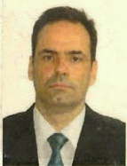

# CARLOS FERNANDES FIDALGO

## Índice
- [Quem sou eu?](#quem-sou-eu)
- [Quais as minhas linguagens?](#quais-as-minhas-linguagens)
- [Badges de Contato](#badges-de-contato)

## 🤔Quem sou eu?
### Me chamo Carlos Fernandes Fidalgo e sou estudante do 4º ano de Engenharia da Computação e Bacharel em TI. Iniciei nesse segundo semestre de 2026 o Curso Técnico de Desenvolvimento de Sistemas na Etec de Dracena. Atualmente trabalho na Polícia Civil do Estado de São Paulo.

## 💻Quais as minhas linguagens?
### Atualmente as linguagens de programação que tenho tido mais contato é o 🐍Python, 📰HTML, 3️⃣CSS e 🍵Java.

## 🔎Badges de Contato
### 📫Gmail: carlosfidalgo.pc@gmail.com
### 📱Instagram: @carlosfidalgo7
### 👤Linkedin: Carlos Fernandes Fidalgo
### 🐈‍⬛Github: carlos17041976

